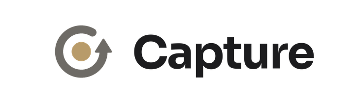

<p align="center">
  <picture>
    <source media="(prefers-color-scheme: dark)" srcset="media/logo-dark.png">
    
  </picture>
</p>

<h3 align="center">Мгновенный повтор для игр на Windows.</h3>

<p align="center">
  Нажмите клавишу или скажите свою фразу — и последние пять минут сохранятся.<br>
  Бесплатно, с открытым кодом, без интернета и настолько легко, что вы забудете, что он работает.
</p>

<p align="center">
  <a href="https://github.com/yasirmz/Capture/releases/latest"></a>
  
  
</p>

<p align="center">
  <a href="../README.md">English</a> ·
  <a href="README.ar.md">العربية</a> ·
  <a href="README.zh-Hans.md">简体中文</a> ·
  <b>Русский</b> ·
  <a href="README.es.md">Español</a> ·
  <a href="README.pt-BR.md">Português (Brasil)</a> ·
  <a href="README.de.md">Deutsch</a>
</p>

## Почему Capture

- **Не упустите момент.** Capture хранит последние от 15 секунд до 20 минут (по умолчанию 5) на диске или в оперативной памяти. Нажмите `Alt+F10` — и это станет клипом.
- **Умное сохранение.** Запишите свою фразу на любом языке, а потом просто скажите её, чтобы сохранить клип или сделать скриншот. Работает без интернета.
- **Лёгкий.** Записывает на видеокарте. Замер во время игры в 1440p60 AV1: 0,4% CPU, ни одного пропущенного кадра.
- **Редактируйте сразу.** Обрезайте, меняйте скорость, добавляйте текст, рисуйте, размывайте и создавайте автосубтитры прямо на своём ПК.
- **Публикация в одно нажатие.** Публикуйте в X, TikTok и Instagram или сразу во все три с одной подписью — либо скопируйте клип и вставьте куда угодно.
- **Приватность.** Без аккаунта и телеметрии. Клипы остаются на вашем ПК, пока вы ими не поделитесь.

## Скачать

1. Скачайте **Capture-Setup.exe** из [последнего выпуска](https://github.com/yasirmz/Capture/releases/latest).
2. Запустите его и следуйте шагам: выберите язык и папку (права администратора не нужны), а также нужен ли ярлык на рабочем столе и запуск Capture вместе с Windows.
3. Играйте и нажмите `Alt+F10`, когда случится что-то стоящее.

Windows может предупредить о неизвестном издателе (установщик пока не подписан): выберите **Подробнее**, затем **Выполнить в любом случае**.
Обновления приходят прямо в приложении и никогда не устанавливаются во время записи. При удалении клипы и настройки сохраняются.

**Требования:** Windows 10 (2004 или новее) или Windows 11, 64-бит. Рекомендуется видеокарта с аппаратным кодировщиком (NVIDIA, AMD или Intel).

## Возможности

<details>
<summary>Всё, что умеет Capture</summary>

- **Захват:** весь экран, до 5 приложений (записывается то, что на переднем плане) или игры (определяются автоматически, в том числе растянутые и в эксклюзивном полноэкранном режиме), до 4K при 30–240 к/с.
- **Мгновенный повтор:** до 20 минут, на диске (SSD или HDD) или в оперативной памяти, быстрый клип рядом и, если нужно, начало заново после каждого сохранения.
- **Автоматическое качество:** Capture сам выбирает кодировщик, размер, частоту кадров и качество, лучшие для вашего ПК, и сам снижает их при пропуске кадров.
- **Кодирование:** AV1, HEVC или H.264 на NVIDIA (NVENC), AMD (AMF) или Intel (Quick Sync); если один не запускается, пишет следующий, вплоть до x264.
- **Звук:** микшер со строкой для каждого источника (игра, Discord, музыка, микрофон, любое приложение или устройство), у каждого своя громкость и при желании своя дорожка.
- **Камера:** веб-камера или телефон в углу (квадратная или круглая) или сверху кадра 9:16, при желании ещё и отдельным файлом.
- **Запись:** запуск, пауза и остановка горячими клавишами; запись с паузами остаётся одним файлом.
- **Скриншоты** со своей горячей клавишей сохраняются рядом с клипами.
- **Библиотека:** клипы и скриншоты по дням с фильтром по игре; перетащите клип прямо в Discord; лимит размера папки; сохранение в OneDrive, Dropbox или Google Drive с освобождением локальных копий.
- **Редактор:** обрезка и склейка, скорость и звук для каждой части (все дорожки), приближение области, текст разными шрифтами и стилями, автосубтитры, рисование, фигуры, размытие, фильтры и кадрирование скриншотов.
- **Автосубтитры:** Whisper на видеокарте. Движок и модель скачиваются один раз после вашего согласия и удаляются в настройках.
- **Публикация:** X, TikTok, Instagram или все сразу через страницу каждого сайта; «Копировать» под 10, 50 или 500 МБ Discord; обрезка по ленте кадров и кадр 9:16; копии хранятся в папке Shared рядом с клипами.
- **Помощь:** «Сохранить отчёт» на странице Статус кладёт журналы и настройки в zip на рабочий стол, чтобы приложить к issue на GitHub.
- **Семь языков:** английский, арабский, китайский, русский, испанский, португальский и немецкий. При первом запуске выбирается язык Windows.
- **Тихий:** запускается вместе с Windows в трее, без всплывающих окон и звуков, пока вы их не включите.

</details>

## Конфиденциальность

- Никакой телеметрии, аналитики и аккаунта Capture.
- Capture выходит в интернет, только чтобы раз в день проверить новую версию на GitHub и скачать её (это можно отключить), опубликовать то, чем вы делитесь, через страницу самого сайта и один раз скачать автосубтитры после вашего согласия (движок с GitHub, модель с Hugging Face).
- Ваши клипы остаются в папке клипов (синхронизируются, только если вы выберете папку OneDrive, Dropbox или Google Drive), а настройки и журналы — на вашем ПК. Умное сохранение и автосубтитры слушают только на вашем ПК, и ваша фраза умного сохранения записывается только там.
- Входы на сайты хранятся во встроенном браузере Capture на вашем ПК (Microsoft Edge WebView2, под защитой Windows, как в Edge) и никогда не попадают в настройки или журналы Capture. При выходе с сайта Capture выходит и из аккаунта Google, Apple или Facebook, через который вы на него входили.
- **Сохранить отчёт** содержит журналы и настройки Capture без вашего имени пользователя Windows и заголовков окон и никогда не содержит входов на сайты или клипов.
- Нашли проблему безопасности? Сообщите о ней приватно: см. [SECURITY.md](../SECURITY.md).

## Частые вопросы

**Безопасен ли Capture для античитов?**

Capture никогда не читает и не меняет память игры. Чтобы записать полноэкранную игру (в любом режиме, чтобы растянутая или эксклюзивная полноэкранная игра не была чёрной), он использует тот же подписанный, совместимый с античитами хук захвата, что и OBS Studio, который разрешают Riot Vanguard, Easy Anti-Cheat и BattlEye. Если игра не отдаёт изображение через хук, Capture сам записывает экран, так что клип никогда не бывает чёрным.

**Появляется ли жёлтая рамка при записи?**

В Windows 11 — нет. В Windows 10 сама Windows рисует жёлтую рамку вокруг приложения в режиме **Приложения** и не даёт программам её скрыть; в режимах **Весь экран** и **Игры** её не бывает.

**Клипы дёргаются выше 60 кадров/с.**

Клип не может быть плавнее вашего экрана или игры: запись 144 кадров/с на экране 60 Гц неравномерно повторяет кадры. Capture предупреждает об этом под частотой кадров, а **Автоматически** в разделе Качество никогда не пишет выше частоты экрана. 60 подходит для YouTube, X, TikTok и Instagram.

**Что-то не работает. Что прислать?**

Нажмите **Сохранить отчёт** на странице Статус: на рабочем столе появится zip с журналами и настройками Capture. Приложите его к [issue на GitHub](https://github.com/yasirmz/Capture/issues).

## Сборка из исходников

<details>
<summary>Для разработчиков</summary>

Capture — приложение на .NET 10 (WPF и WinForms), которое использует **libobs**, движок [OBS Studio](https://obsproject.com), только с нужными модулями, а для редактирования и публикации — FFmpeg.

```powershell
.\tools\build-whisper.ps1               # once: the auto captions engine (needs the Vulkan SDK and VS Build Tools)
.\tools\release.ps1                     # the Setup, update files and source zip in releases\ (needs vpk 1.2.161)
dotnet run --project tests\Capture.Tests # the tests
```

Сборка копирует libobs 32.2.2 из установленного OBS Studio.

</details>

## Лицензия

Capture — свободное ПО под [GNU General Public License v2.0 или новее](../LICENSE), той же лицензией, что и у libobs. Каждый выпуск содержит полный исходный код. Сторонние компоненты и их лицензии перечислены в [THIRD-PARTY-NOTICES.md](../THIRD-PARTY-NOTICES.md).

<sub>Capture основан на [Kairos](https://github.com/BasilForge/Kairos) от BasilForge и распространяется по той же лицензии.</sub>
